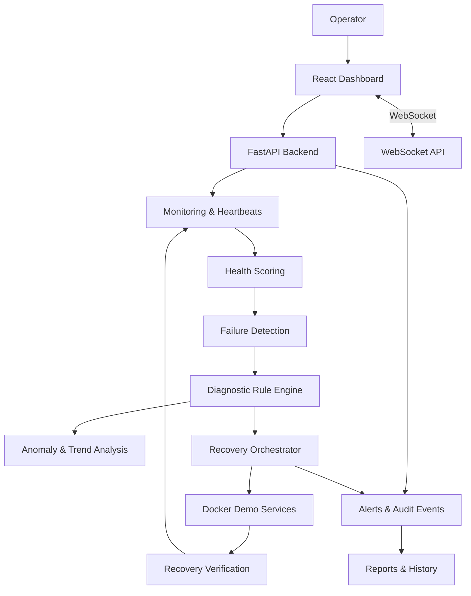

<div align="center">


<h3>Intelligent Infrastructure Monitoring & Automated Recovery</h3>

<p>
  A Docker-based platform for monitoring containerized services,
  detecting failures, diagnosing issues, and orchestrating recovery.
</p>


<br/>

<a href="https://github.com/rohanthanuj06-rgb/CLOUD_SENTINEL">Repository</a>
&nbsp; • &nbsp;
<a href="https://github.com/rohanthanuj06-rgb/CLOUD_SENTINEL/issues">Report an Issue</a>
&nbsp; • &nbsp;
<a href="https://github.com/rohanthanuj06-rgb">Developer Profile</a>

</div>

---

## Overview

**CloudSentinel** is an intelligent infrastructure monitoring and recovery platform designed to improve the visibility, reliability, and resilience of containerized services.

Modern applications depend on multiple services working together. When a service becomes unhealthy, overloaded, or unresponsive, the resulting downtime can affect the entire application.

CloudSentinel brings monitoring, health scoring, diagnostic analysis, anomaly detection, recovery orchestration, and audit reporting into one dashboard.

Instead of requiring a separate virtual machine for this academic prototype, CloudSentinel uses Docker containers as monitored workloads. This provides a practical way to demonstrate important cloud computing and virtualization management concepts on a local development machine.

### The core workflow

<div align="center">

```text
┌────────────────────────────┐
│  Containerized Services    │
└─────────────┬──────────────┘
              ↓
┌────────────────────────────┐
│  Monitoring & Heartbeats   │
└─────────────┬──────────────┘
              ↓
┌────────────────────────────┐
│  Health Scoring & Analysis │
└─────────────┬──────────────┘
              ↓
┌────────────────────────────┐
│  Failure Detection         │
└─────────────┬──────────────┘
              ↓
┌────────────────────────────┐
│  Diagnostics & Prediction  │
└─────────────┬──────────────┘
              ↓
┌────────────────────────────┐
│  Recovery Orchestration    │
└─────────────┬──────────────┘
              ↓
┌────────────────────────────┐
│  Recovery Verification     │
└─────────────┬──────────────┘
              ↓
┌────────────────────────────┐
│  Alerts, Audit & Reports   │
└────────────────────────────┘
```

</div>

## Why CloudSentinel?

Traditional monitoring tools may identify a service failure but leave diagnosis, remediation, and verification to an operator.

CloudSentinel explores a more integrated approach:

- **Monitor:** Collect service health and resource-related metrics.
- **Evaluate:** Calculate health scores and identify unhealthy states.
- **Detect:** Identify failures, missed heartbeats, and unusual behavior.
- **Diagnose:** Apply diagnostic rules and fault-classification logic.
- **Recover:** Execute configured recovery actions.
- **Verify:** Check whether the service has returned to a healthy state.
- **Record:** Maintain alerts, recovery history, audit events, and reports.

The objective is to demonstrate a complete monitoring-to-recovery workflow in a local, Docker-based environment.

## Key Features

### 1. Infrastructure & Service Monitoring

- Monitor multiple containerized demo services.
- View service health and availability.
- Track resource metrics where supported by the monitoring implementation.
- Use heartbeat and health-check information to identify unresponsive workloads.
- Inspect individual service details.

### 2. Health Scoring

CloudSentinel includes a health-scoring module designed to combine available health signals into an understandable service status.

Potential inputs include:

- CPU utilization
- Memory utilization
- Disk-related metrics
- Network or response behavior
- Health-check results
- Heartbeat status

The actual inputs, weights, and thresholds depend on the implemented scoring configuration.

### 3. Failure Detection & Diagnostics

- Detect unhealthy or unavailable services.
- Identify missed heartbeats and health-check failures.
- Classify faults using diagnostic rules.
- Present diagnostic information to help operators understand failures.
- Maintain a record of detected incidents.

### 4. Anomaly & Trend Analysis

The prediction modules support analysis of monitored data to help identify unusual behavior and potentially deteriorating service health.

Depending on the configured implementation, this can include:

- Metric trend analysis
- Unusual metric-pattern detection
- Early-warning indicators
- Historical health analysis

> Anomaly detection and predictive warnings are decision-support mechanisms. They do not guarantee that every future failure will be predicted.

### 5. Automated Recovery

CloudSentinel is designed around a recovery workflow that can include:

1. Detecting an unhealthy service.
2. Evaluating the fault and selecting a recovery action.
3. Executing an authorized recovery operation.
4. Verifying the resulting service state.
5. Recording the outcome.
6. Raising an alert if recovery fails.

Recovery actions should be restricted to explicitly configured and authorized workloads.

### 6. Real-Time Dashboard

The React-based interface organizes monitoring information into pages for operational visibility.

The project frontend includes pages for:

- Dashboard
- Health monitoring
- Infrastructure
- Node details
- Alerts
- Diagnostics
- Predictions
- Fault injection
- Recovery center
- Audit logs
- Reports
- Settings

### 7. Alerts, Audit & Reporting

- Review generated alerts.
- Inspect recovery history.
- Track recorded system events.
- Review audit logs.
- Access diagnostic and reporting views.

The availability and persistence of individual records depend on the application's configured storage and backend implementation.

### 8. Fault Injection & Testing

A fault-injection interface and demo workloads can be used to explore failure scenarios in a controlled development environment.

Examples may include stopping a demo service, making a health check fail, or simulating an unhealthy workload.

**Safety:** Use fault injection only on your own local demo services or other explicitly authorized test environments.

---

## Technology Stack

| Component | Technology | Purpose |
|---|---|---|
| Backend | Python, FastAPI | API endpoints and application logic |
| Frontend | React, Vite | Monitoring dashboard and user interface |
| Styling | CSS, Tailwind-related configuration | Dashboard layout and styling |
| Containerization | Docker | Isolated services and repeatable execution |
| Service orchestration | Docker Compose | Local multi-container environment |
| Monitoring | Custom Python monitoring modules | Health checks, metrics and heartbeats |
| Diagnostics | Rule engine and classifier modules | Fault analysis |
| Prediction | Anomaly detector and trend analyzer | Metric analysis |
| Recovery | Recovery orchestrator and verifier | Recovery workflow management |
| Testing | pytest | Backend tests |
| Data integration | Firebase integration and local fallback modules | Configurable data persistence/integration |

*The table describes the technologies and modules indicated by the project structure. Confirm exact package versions and enabled integrations in the project configuration.*

---

## System Architecture

CloudSentinel separates the user interface, API layer, monitoring logic, diagnostic modules, and recovery workflows.



### Architectural components

**Frontend layer**

Provides dashboard pages, metric visualizations, service details, diagnostic information, recovery controls, and audit views.

**API layer**

Exposes backend functionality through organized API modules for nodes, alerts, diagnostics, faults, predictions, recovery, reports, audit events, and system information.

**Monitoring layer**

Collects health information and evaluates service status through monitoring, heartbeat, and health-scoring modules.

**Intelligence layer**

Uses diagnostic rules, fault classification, anomaly detection, and trend analysis to support incident investigation.

**Recovery layer**

Coordinates recovery actions and checks whether a workload has returned to an acceptable state.

**Audit and reporting layer**

Provides visibility into incidents, system activity, and recovery outcomes.

---

## Project Structure

```text
CLOUD_SENTINEL/
│
├── backend/
│   ├── app/
│   │   ├── api/
│   │   │   ├── alerts.py
│   │   │   ├── audit.py
│   │   │   ├── diagnostics.py
│   │   │   ├── faults.py
│   │   │   ├── nodes.py
│   │   │   ├── predictions.py
│   │   │   ├── recovery.py
│   │   │   ├── reports.py
│   │   │   ├── system.py
│   │   │   └── websocket.py
│   │   ├── core/
│   │   ├── diagnostics/
│   │   ├── firebase/
│   │   ├── models/
│   │   ├── monitoring/
│   │   ├── prediction/
│   │   ├── recovery/
│   │   ├── schemas/
│   │   └── main.py
│   ├── tests/
│   ├── Dockerfile
│   ├── requirements.txt
│   └── pytest.ini
│
├── frontend/
│   ├── public/
│   ├── src/
│   │   ├── charts/
│   │   ├── components/
│   │   ├── hooks/
│   │   ├── pages/
│   │   ├── services/
│   │   ├── App.jsx
│   │   └── main.jsx
│   ├── Dockerfile
│   ├── nginx.conf
│   └── package.json
│
├── infrastructure/
│   ├── demo-nodes/
│   └── docker-compose.yml
│
├── docs/
│   ├── api.md
│   ├── architecture.md
│   ├── database.md
│   ├── fault-injection.md
│   ├── firebase.md
│   ├── monitoring.md
│   ├── recovery.md
│   └── testing.md
│
├── scripts/
│   ├── run_local.ps1
│   └── test_all.ps1
│
├── .env.example
├── docker-compose.yml
└── README.md
```

*This is a high-level overview; additional files may exist in the repository.*

---

## Getting Started

### Prerequisites

Install the following before running the application:

- [Git](https://git-scm.com/)
- [Docker Desktop](https://www.docker.com/products/docker-desktop/)
- Docker Compose support through Docker Desktop
- A Windows PowerShell terminal or a compatible shell

Verify the installations:

```powershell
git --version
docker --version
docker compose version
```

### 1. Clone the repository

```powershell
git clone https://github.com/rohanthanuj06-rgb/CLOUD_SENTINEL.git
cd CLOUD_SENTINEL
```

### 2. Configure environment variables

Create your local environment file from the example:

```powershell
Copy-Item .env.example .env
```

Open `.env` and configure the required values according to the comments in `.env.example` and the project documentation.

Do not commit `.env` or expose API tokens, passwords, Firebase credentials, or other secrets. Keep `.env.example` limited to placeholder values.

### 3. Start Docker Desktop

Make sure Docker Desktop is running before continuing.

### 4. Build and launch the application

From the repository root, run:

```powershell
docker compose config
docker compose up --build -d
```

The first command validates the Compose configuration. The second builds the images and starts the configured services.

Check the container status:

```powershell
docker compose ps
```

Inspect the logs if a service does not start:

```powershell
docker compose logs --tail=100
```

Follow live logs:

```powershell
docker compose logs -f
```

**Important:** The actual frontend and API URLs depend on the port mappings in your Compose files. Check `docker-compose.yml` and `infrastructure/docker-compose.yml` rather than assuming default ports.

### 5. Open the application

Use the host ports shown by:

```powershell
docker compose ps
```

If the API exposes FastAPI's default documentation route and port mapping, its interactive documentation is usually available at:

```text
http://localhost:<API_PORT>/docs
```

Replace `<API_PORT>` with the actual published API port. Check the API configuration if documentation is disabled or mounted at a different path.

### 6. Stop the application

```powershell
docker compose down
```

To rebuild after code changes:

```powershell
docker compose up --build -d
```

> Avoid `docker compose down -v` unless you intentionally want to remove Compose-managed volumes and the data stored in them.

---

## Testing

CloudSentinel contains a backend test suite covering areas such as API behavior, classification, diagnostics, health scoring, predictions, and recovery.

From the project root, the documented PowerShell helper can be inspected and used if its prerequisites are installed:

```powershell
.\scripts\test_all.ps1
```

Alternatively, run pytest inside the backend environment:

```powershell
cd backend
python -m pip install -r requirements.txt
python -m pytest -v
```

The exact test commands may depend on how your local environment is configured. Review `scripts/test_all.ps1` and `docs/testing.md` for the project's intended procedure.

### Suggested end-to-end validation

1. Start the Docker services.
2. Confirm that demo workloads appear in the dashboard.
3. Verify that health and heartbeat information is being updated.
4. Inspect the diagnostic view.
5. Trigger a fault only against an authorized demo workload.
6. Confirm that the failure is detected.
7. Observe the configured recovery action.
8. Verify whether the service returns to a healthy state.
9. Inspect alerts, audit events, and recovery history.
10. Restore the demo environment to its normal state.

---

## Security Considerations

CloudSentinel is intended as a development and academic prototype unless separately hardened and validated for production.

- Never commit secrets or credentials.
- Restrict Docker access to trusted users.
- Do not expose the Docker daemon to untrusted networks.
- Protect recovery and fault-injection endpoints.
- Validate inputs and enforce authorization for sensitive operations.
- Use only explicitly approved workloads for automatic recovery.
- Configure Firebase or other external integrations securely if enabled.
- Review logs before sharing them publicly; they may contain sensitive information.

A monitoring dashboard is not, by itself, a security boundary. Production deployments require appropriate authentication, authorization, network controls, secrets management, and operational safeguards.

---

## Current Scope & Limitations

CloudSentinel demonstrates concepts associated with cloud infrastructure management using locally orchestrated Docker containers.

- Docker containers are used as monitored workloads; this does not make them full virtual machines.
- Actual monitoring coverage depends on the metrics and collectors implemented.
- Predictions are estimates and should not be treated as guaranteed failure forecasts.
- Recovery depends on the configured actions, permissions, and health checks.
- Firebase functionality depends on the selected configuration and credentials.
- Local Docker monitoring is not equivalent to monitoring an entire remote cloud provider.

These boundaries are important when interpreting the project's results or extending it to real infrastructure.

---

## Future Enhancements

Potential future directions include:

- Adaptive thresholds and improved failure prediction.
- More robust time-series anomaly detection.
- Role-based access control and stronger authentication.
- Configurable recovery policies and approval workflows.
- Notification integrations for incidents.
- Historical performance analysis and capacity planning.
- Support for monitoring remote Docker hosts.
- Kubernetes monitoring and orchestration integration.
- CI workflows for automated testing and image builds.
- Deployment hardening, observability, and backup strategies.

These are future possibilities rather than claims that all features are currently implemented.

---

## Academic Context

**Project title:** CloudSentinel: Intelligent VM Health Monitoring, Failure Detection and Self-Recovery Platform

**Domain:** Cloud Computing & Virtualization

**Implementation approach:** Docker-based service monitoring and recovery simulation

**Primary objective:** Demonstrate how monitoring, fault detection, diagnostics, and recovery verification can be combined into a single infrastructure management workflow without requiring a separately created virtual machine.

---

## Author

<div align="center">

### Rohan Thanuj

B.Tech Information Technology Student | Aspiring Software Developer

<a href="https://github.com/rohanthanuj06-rgb">
  
</a>
<a href="https://www.linkedin.com/in/rohan-thanuj-9b451b352">
  
</a>

<br/><br/>

*Learn continuously. Build intelligently. Recover reliably.*


</div>
