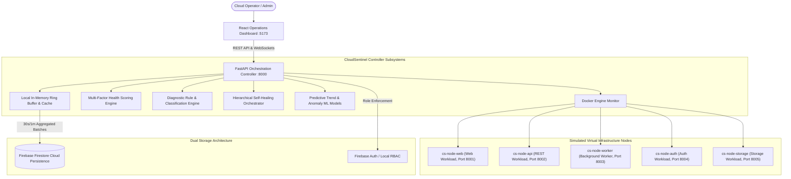

# CLOUDSENTINEL
### Intelligent Virtual Infrastructure Health Monitoring, Failure Detection and Self-Recovery Platform
*Academic Alternative Title: An Intelligent Cloud-Based System for Virtual Machine/Container Failure Detection and Automated Recovery*

---

## 1. Project Overview & Academic Novelty

**CloudSentinel** is a production-style, intelligent cloud operations center and autonomous self-healing platform. It monitors containerized virtual infrastructure, calculates multi-factor health scores, classifies failure states, diagnoses probable root causes, and executes hierarchical recovery with post-action verification.

### Academic Contribution & Novelty
Rather than claiming that "no monitoring system exists," CloudSentinel's core contribution is an **integrated lightweight platform** combining:
1. Multi-metric infrastructure health scoring (CPU, RAM, Network, Latency, Heartbeat, Application)
2. Application-level vs. container-level failure discrimination (detecting dead applications inside running containers)
3. 12-state infrastructure classification
4. Rule-based root-cause diagnosis with confidence scores and evidence chains
5. Hierarchical self-healing (Application restart -> Container restart -> Recreate -> Failover -> Escalation)
6. Post-recovery health verification (never blindly assuming recovery succeeded)
7. Machine learning degradation forecasting (Linear Regression) and multivariate anomaly detection (Isolation Forest)
8. Prolonged idle & zombie container workload detection
9. Recovery confidence approval gating
10. Immutable audit trails and executive reliability reporting

> **Virtualization Constraint Note**:
> This platform runs completely locally on a single laptop using **Docker Desktop**. Containers honestly represent containerized virtual infrastructure workloads rather than full VirtualBox/VMware virtual machines, simulating a private cloud cluster without requiring paid cloud infrastructure.

---

## 2. High-Level Architecture



---

## 3. Technology Stack & Requirements

### System Prerequisites
To run CloudSentinel locally on your laptop:
- **Operating System**: Windows 10/11 (or macOS / Linux)
- **Python**: 3.11 or higher
- **Node.js**: v18.0.0 or higher (v20+ recommended)
- **Docker Desktop**: Installed and running (or run in built-in High-Fidelity Simulator mode)

### Backend Requirements (`backend/requirements.txt`)
- `fastapi` & `uvicorn[standard]` (REST and WebSocket controller)
- `pydantic` & `pydantic-settings` (Data schemas and configuration)
- `psutil` (System resource telemetry)
- `docker` (Python Docker SDK for container operations)
- `scikit-learn`, `pandas`, `numpy` (ML degradation forecasting & anomaly detection)
- `httpx` & `aiofiles` (Asynchronous HTTP probing and file I/O)
- `websockets` (Real-time live telemetry streaming)
- `firebase-admin` (Optional Firebase Authentication and Firestore persistence)
- `pytest` & `pytest-asyncio` (Automated testing suite)

### Frontend Requirements (`frontend/package.json`)
- `React 19` & `Vite 8` (Modern high-performance UI framework)
- `Tailwind CSS v3` (Modern dark operations center theme)
- `Lucide React` (Vector infrastructure icons)
- `Recharts` (Interactive time-series line charts, radar diagrams)

---

## 4. Quick Start & Execution

### Option A: Complete Docker Compose Run (Recommended)
From the project root:
```bash
# Build and launch all 7 containers (Backend, Frontend, 5 Workload Nodes):
docker compose up --build

# To run in background:
docker compose up -d

# To stop:
docker compose down
```

### Option B: Local PowerShell Launch (Zero Docker Build Wait)
From the project root in PowerShell:
```powershell
# One-click launcher:
.\scripts\run_local.ps1
```
Or start manually in two terminals:

**Terminal 1 (Backend Controller):**
```powershell
cd backend
.\.venv\Scripts\uvicorn.exe app.main:app --host 0.0.0.0 --port 8000 --reload
```

**Terminal 2 (React Operations Dashboard):**
```powershell
cd frontend
npm run dev
```

- **Operations Dashboard**: [http://localhost:5173](http://localhost:5173) (or `http://localhost:3000` via Docker)
- **FastAPI OpenAPI Swagger Documentation**: [http://localhost:8000/docs](http://localhost:8000/docs)

---

## 5. Live Demonstration Scenarios

| Scenario | Injected Failure | Platform Response |
|---|---|---|
| **Scenario 1: Normal Cluster** | None (nominal) | All 5 nodes report `HEALTHY`, Health Scores `90-98%`. Heartbeats active. |
| **Scenario 2: CPU Overload** | Click **CPU STRESS** on `cs-node-web` | CPU spikes to 95%. State changes to `OVERLOADED`. Diagnostic engine flags `CPU_OVERLOAD`. |
| **Scenario 3: Application Crash** | Click **CRASH APPLICATION LAYER** on `cs-node-api` | Container remains alive, but `/health` returns 500. Engine detects application-level crash and executes Tier 1 Application Restart. |
| **Scenario 4: Container Crash** | Click **TERMINATE CONTAINER** on `cs-node-worker` | Heartbeat lost. Socket disconnected. Tier 2 Container Restart recovers node. Health restored to `HEALTHY`. |
| **Scenario 5: Memory Leak** | Click **INJECT MEMORY PRESSURE** on `cs-node-storage` | RAM allocation reaches threshold. `MEMORY_EXHAUSTION` diagnosed. Container restarted. |
| **Scenario 6: Zombie Detection** | Low CPU/Net over duration | Workload flagged as `ZOMBIE` for operator resource consolidation. |
| **Scenario 7: Low Confidence Gate** | Unknown failure signature | Confidence < 50% suspends self-healing into `REQUIRES_APPROVAL` until Admin approves. |

---

## 6. Project Structure

```
cloudsentinel/
├── backend/
│   ├── app/
│   │   ├── main.py                  # FastAPI application entrypoint & lifespan
│   │   ├── config.py                # Pydantic configuration & threshold settings
│   │   ├── api/                     # REST API routers (nodes, alerts, recovery, faults, etc.)
│   │   ├── core/                    # Security, RBAC, EventBus Pub/Sub
│   │   ├── monitoring/              # Docker SDK monitor, health scoring, heartbeat tracker
│   │   ├── diagnostics/             # Rule engine root-cause diagnosis & 12-state classifier
│   │   ├── recovery/                # Hierarchical recovery orchestrator & verifier
│   │   ├── prediction/              # Scikit-learn trend forecasting & Isolation Forest
│   │   ├── firebase/                # Firestore persistence & Local Demo Mode fallback
│   │   ├── models/                  # Pydantic data schemas
│   │   └── schemas/                 # Request/response DTOs
│   ├── tests/                       # Complete pytest suite (21 automated unit tests)
│   ├── Dockerfile
│   └── requirements.txt
├── frontend/
│   ├── src/
│   │   ├── components/              # Navbar, Sidebar, Topology Map, Gauges, Modals
│   │   ├── charts/                  # Metric history line charts, radar diagrams, recovery timelines
│   │   ├── pages/                   # Dashboard, Topology, Details, Faults, Recovery, etc.
│   │   ├── hooks/                   # useNodes, useWebSocket
│   │   ├── services/                # API client
│   │   ├── App.jsx                  # Main application router
│   │   └── index.css                # Dark cyber operations center design system
│   ├── Dockerfile
│   └── package.json
├── infrastructure/
│   ├── docker-compose.yml           # Multi-container orchestration
│   └── demo-nodes/                  # 5 Lightweight Python microservice workloads
│       ├── node-web/
│       ├── node-api/
│       ├── node-worker/
│       ├── node-auth/
│       └── node-storage/
├── docs/                            # Architectural, API, Recovery, & Testing documentation
├── scripts/                         # One-click PowerShell run and test scripts
├── docker-compose.yml               # Root compose file
├── .env.example                     # Environment template
└── README.md
```

---

## 7. Testing Suite Execution

Run all unit and integration tests with pytest:
```powershell
cd backend
.\.venv\Scripts\pytest.exe -v
```
All 21 test cases (scoring, classification, diagnosis, recovery, prediction, API security) pass out-of-the-box.

---

## 8. License & Academic Mentorship
Designed and engineered for Advanced Cloud Infrastructure, Distributed Systems, and DevOps academic demonstration.
# CLOUD_SENTINEL

