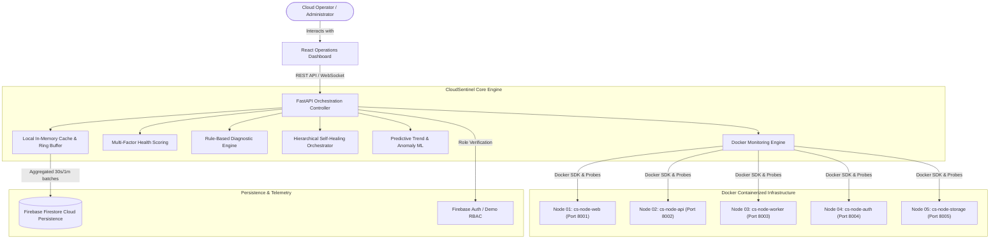
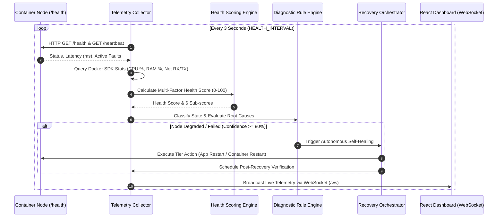

# CloudSentinel System Architecture

## 1. Executive Summary

**CloudSentinel** (*An Intelligent Cloud-Based System for Virtual Machine/Container Failure Detection and Automated Recovery*) is an autonomous infrastructure health monitoring, fault diagnosis, and self-healing platform.

The system is designed to run entirely locally on a single physical machine using **Docker Desktop**, containerizing workloads to simulate a private cloud testbed without requiring paid cloud vendors or heavy VirtualBox/VMware virtual machines.

---

## 2. High-Level Architecture Diagram

---

## 3. Telemetry and Data Flow Diagram

---

## 4. Architectural Boundaries and Security

1. **Host Isolation**: All fault injections (CPU stress, memory leakage, disk filling) execute strictly inside designated isolated demo containers. The host machine is never exposed to destructive operations.
2. **Docker Socket Access**: Only the backend Python controller communicates with `/var/run/docker.sock` via the official Docker SDK. The frontend has zero Docker socket access.
3. **Dual Operation Mode**:
   - **Live Docker Daemon**: Connects via Docker SDK when Docker Desktop is running.
   - **High-Fidelity Virtual Simulator**: Seamless fallback mode if Docker Desktop is offline, ensuring continuous system testing without crashes.
