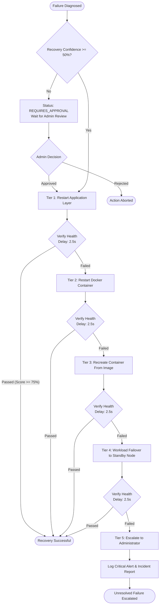

# CloudSentinel Hierarchical Recovery Engine

## 1. Overview

Blindly restarting containers or hosts whenever a failure occurs is dangerous and wasteful. **CloudSentinel** implements a tiered hierarchical recovery strategy:

```
FAILURE DETECTED
       │
       ▼
Tier 1: Restart Application Process (via REST /restart_app)
       │
   Passed? ──► YES ──► Verify Health ──► RECOVERY COMPLETED
       │
      NO
       ▼
Tier 2: Restart Container (via Docker SDK container.restart)
       │
   Passed? ──► YES ──► Verify Health ──► RECOVERY COMPLETED
       │
      NO
       ▼
Tier 3: Recreate Container Fresh (destroy & recreate clean image)
       │
   Passed? ──► YES ──► Verify Health ──► RECOVERY COMPLETED
       │
      NO
       ▼
Tier 4: Workload Failover (redirect traffic to healthy standby node)
       │
   Passed? ──► YES ──► Verify Health ──► RECOVERY COMPLETED
       │
      NO
       ▼
Tier 5: Administrator Escalation (CRITICAL Alert & Incident Audit)
```

---

## 2. Recovery Flow Mermaid Diagram



---

## 3. Post-Recovery Health Verification

A recovery is never assumed successful simply because a command completed without exit code errors.

The `RecoveryVerifier` executes the following checks:
1. **Stabilization Delay**: Waits a configurable stabilization window (default 2.5 seconds).
2. **Container State**: Confirms Docker container status is `running`.
3. **Heartbeat Re-Probe**: Probes `/heartbeat` to ensure ping viability.
4. **Application Probe**: Queries HTTP `/health` expecting HTTP 200 OK.
5. **Latency Measurement**: Verifies response latency is sub-second.
6. **Health Score Delta**: Recalculates composite score and verifies `health_after >= 65.0`.
7. **Audit Logging**: Emits an immutable audit log with pre- and post-recovery health metrics.
